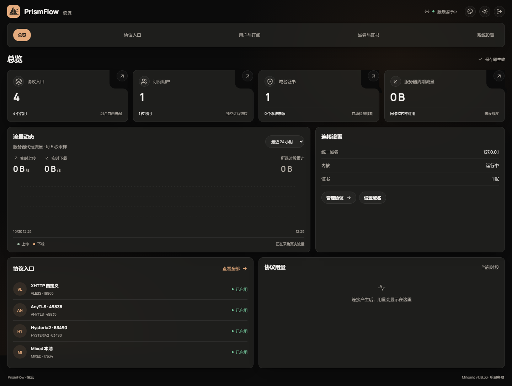
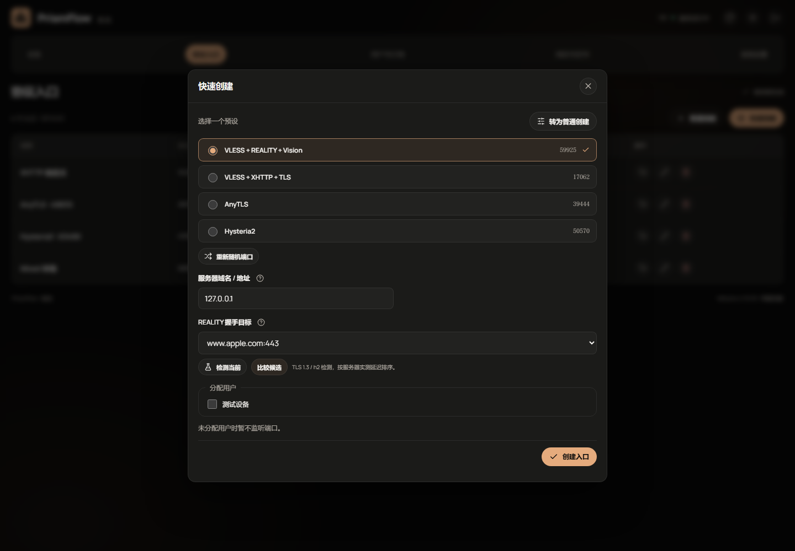
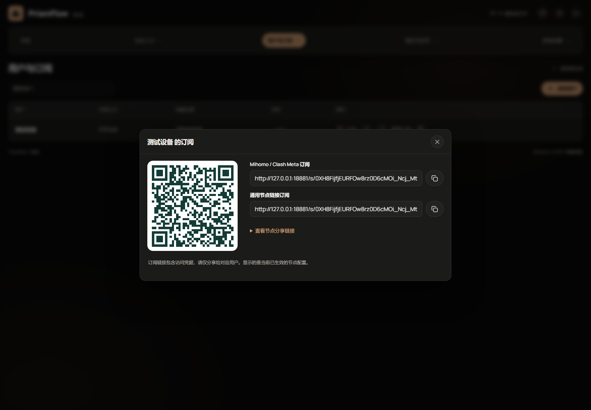

<div align="center">


# PrismFlow · 棱流

**轻量、可视化的 Mihomo 服务端管理面板**

创建协议、管理证书、分配用户、获取订阅，在一处完成。


<a href="LICENSE"></a>

[界面预览](#界面预览) · [一键安装](#一键安装) · [脚本安装](#脚本安装) · [Docker 安装](#docker-安装) · [首次使用](#首次使用) · [使用文档](#使用文档)

</div>

PrismFlow 面向个人与小团队的单台 VPS，使用 **Go + SQLite**，将 React 前端嵌入可执行文件。运行时不需要 Node.js、Redis 或外部数据库；支持 Docker 与 systemd 部署。

## 界面预览



暖黑与香槟橙、可调玻璃效果，支持明暗主题和手机操作。新增、订阅查看与重置确认均在弹窗中完成。

<details>
<summary>查看协议创建、订阅与更多界面</summary>

| 快速创建 | 用户订阅 |
| --- | --- |
|  |  |

[普通创建与字段帮助](docs/screenshots/field-help.png) · [系统设置](docs/screenshots/settings.png) · [流量与记录](docs/screenshots/settings-traffic.png) · [浅色主题](docs/screenshots/light.png) · [手机总览](docs/screenshots/mobile.png)

</details>

## 核心能力

| 能力 | 你可以做什么 |
| --- | --- |
| 协议编排 | 四种常用预设快速创建，携带参数切换到普通表单；自动生成五位端口并检查冲突 |
| 内核管理 | 下载并管理 Mihomo；面板自身支持稳定版检测和手动 / 自动更新；保存配置后自动应用 |
| 域名与证书 | 分开设置面板、订阅与节点地址；生成反代配置；复用系统证书或 ACME 签发，展示 SAN 覆盖范围 |
| 用户与订阅 | 为用户选择可用入口，生成 Mihomo YAML、分享链接与二维码；节点名称带用户名前缀 |
| 连通性检测 | 分步检查入口，用隔离客户端发起真实协议请求，不重载在线内核，无直连回退 |
| 流量与网站 | 代理流量图表、服务器周期额度与订阅 Header；可选启用静态伪装网站及 Hysteria2 回落 |
| 维护与恢复 | 加密配置备份、运行事件、证书文件变更检测；配置校验或启动失败时保留原配置 |

### 常用协议，一步起配

| 快速预设 | 传输 | 所需信息 |
| --- | --- | --- |
| VLESS + REALITY + Vision | TCP | 服务器地址、合适的握手目标；无需自有证书 |
| VLESS + XHTTP + TLS | XHTTP | 节点地址；反代维护 TLS，或绑定内核证书 |
| AnyTLS | TCP | 服务器地址、TLS 证书 |
| Hysteria2 | QUIC / UDP | 服务器地址、TLS 证书、可用 UDP |

每次选择一个预设，可转为普通创建继续修改。普通表单支持 **VLESS、VMess、Trojan、AnyTLS、Hysteria2、TUIC v5、Shadowsocks**；原生 YAML / JSON 模式开放锁定内核的 **20 种监听器**。

> [!NOTE]
> 原生模式自行管理认证和客户端配置，不自动生成用户订阅。监听器范围以 Mihomo **v1.19.33** 为准；下载内核不会自动追随最新版。协议组合与限制见 [协议说明](docs/PROTOCOLS.md)。

## 一键安装

根据部署方式选择下方的 **本地（原生）安装** 或 **Docker 安装** 命令，执行后直接安装，无需再交互选择。

安装器自动识别 amd64 / arm64，下载最新稳定 Release，校验 SHA-256 并完成部署。首次安装需等待首个版本 Tag 的 Release 工作流完成；没有可用 Release 时会明确提示。

### 脚本安装

本地（原生）版本适用于 **Debian 12 / 13、Ubuntu 22.04 / 24.04**，需要 systemd。无需手动下载或编译：

```bash
curl -fsSL https://github.com/ydfk/prismflow/releases/latest/download/install.sh | sudo bash -s -- --mode native
```

安装完成后查看状态与初始化令牌：

```bash
sudo systemctl status prismflow --no-pager
sudo cat /var/lib/prismflow/setup.token
```

原生版本支持面板内检查版本、确认手动更新与可选的稳定版自动更新。自动更新默认关闭；需要安装时直接启用，可追加 `--auto-update`。代理内核在首次登录后由面板下载，面板升级不会替换受管 Mihomo。

<details>
<summary>指定版本或使用本地安装包</summary>

指定已发布版本：

```bash
curl -fsSL https://github.com/ydfk/prismflow/releases/latest/download/install.sh | sudo bash -s -- --mode native --version v0.1.0
```

也可从 [Releases](https://github.com/ydfk/prismflow/releases) 下载对应架构的原生归档和 SHA256SUMS，以 amd64 为例：

```bash
sha256sum --ignore-missing -c SHA256SUMS
tar -xzf prismflow-linux-amd64.tar.gz
cd prismflow-linux-amd64
sudo bash scripts/install.sh ./prismflow
```

开发者可在 Linux 构建机准备 Go 1.25+、Node.js 22 与 npm，执行 `bash scripts/build.sh` 生成本地安装包；未指定 VERSION 的本地构建标记为 dev。

</details>

### Docker 安装

Docker 版使用独立的一键命令，执行后直接安装：

```bash
curl -fsSL https://github.com/ydfk/prismflow/releases/latest/download/install.sh | sudo bash -s -- --mode docker
```

安装器从 Docker Hub 拉取 [`ydfk/prismflow`](https://hub.docker.com/r/ydfk/prismflow) 的确切版本，自动选择 amd64/arm64，不需要在 VPS 编译源码。上述 Debian / Ubuntu 系统未安装 Docker 时，会从 Docker 官方 APT 仓库安装 Engine 与 Compose 插件。

| 位置 | 用途 |
| --- | --- |
| `/opt/prismflow/compose.yaml` | 生产部署配置，升级时保留自定义修改 |
| `/opt/prismflow/data` | 持久化数据，容器内为 `/data` |
| `/opt/prismflow/image-version` | 当前完整 Hub 镜像名，如 `ydfk/prismflow:1.2.3` |

容器以 UID `10001` 运行，使用 Linux host 网络。新增 TCP / UDP 入口直接监听宿主机，仍需开放服务器与云防火墙。跨原生 / Docker 模式迁移前需先备份并卸载旧服务，安装器不会覆盖另一种已有部署。

<details>
<summary>Docker 常用命令、证书挂载与源码构建</summary>

也可克隆仓库直接使用默认 Compose，从 Docker Hub 拉取并启动：

```bash
docker compose pull
docker compose up -d
```

仓库 Compose 默认使用 `ydfk/prismflow:latest`；生产环境建议通过 `PRISMFLOW_IMAGE=ydfk/prismflow:已发布版本` 固定版本。`latest` 只随稳定版更新，预发布仅提供完整版本标签。首次 Tag 发布前 Hub 镜像不可用。

一键安装后：

```bash
cd /opt/prismflow
export PRISMFLOW_IMAGE="$(cat image-version)"
docker compose ps
docker compose logs -f prismflow
docker compose exec prismflow cat /data/setup.token
```

使用宿主证书时在安装后的 Compose 中追加只读挂载：

```yaml
volumes:
  - ./data:/data
  - /etc/letsencrypt:/etc/letsencrypt:ro
```

挂载应包含 live 符号链接指向的 archive，且 UID 10001 具备读取权限。

开发者可在完整源码目录中显式叠加源码构建文件；仓库 Compose 使用命名卷，而不是一键安装器的 bind 数据目录：

```bash
docker compose -f compose.yaml -f compose.build.yaml up -d --build
docker compose exec prismflow cat /data/setup.token
```

Docker Desktop 的 host 网络需要另行启用。两种 Docker 部署方式的数据目录不能直接混用。

</details>

## 首次使用

默认管理地址为 `http://127.0.0.1:8080`。远程 VPS 可在自己的电脑建立 SSH 隧道，再用浏览器打开该地址：

```bash
ssh -N -L 8080:127.0.0.1:8080 your-user@your-server
```

1. **初始化管理员**：填写安装步骤读取的 `setup.token`，设置用户名与至少 12 字节的密码。初始化成功后令牌文件自动删除。
2. **准备内核与证书**：在「系统设置」安装内核；在「域名与证书」设置面板、订阅和节点地址；REALITY 与外部 TLS 的 XHTTP 无需绑定内核证书。
3. **创建入口并分配用户**：使用快速或普通创建，再为用户选择协议。托管入口没有启用的关联用户时不监听。
4. **配置公开订阅地址**：将订阅域名反代至 8081，保存公开 HTTPS 根地址，在用户列表打开订阅弹窗，复制链接或扫描二维码导入客户端。
5. **验证连接**：使用入口检测，再在实际客户端确认公网可达性；按需设置流量周期与伪装网站。

### 对外访问与端口

| 默认监听 | 用途 | 部署方式 |
| --- | --- | --- |
| `127.0.0.1:8080` | 管理面板与管理 API | SSH 隧道，或独立管理域名的 HTTPS 反向代理 |
| `127.0.0.1:8081` | 订阅、伪装网站、ACME HTTP 验证 | 公开域名的 HTTPS 反向代理 |
| `127.0.0.1:9097` | Mihomo 控制器 | 仅本机使用 |
| 随机五位端口 | 代理协议入口 | 按协议开放 TCP / UDP |

已有 Caddy / Nginx 可继续负责网页 HTTPS。面板内「公网访问设置」按管理、订阅和节点分工生成反代配置；XHTTP 可经反代使用公网 443，其他协议保持直连随机端口。保存不会批量改动已有节点。详见 [域名、反代与证书](docs/DOMAINS.md) 和 [Caddy 示例](deploy/Caddyfile.example)。

> [!IMPORTANT]
> 网站与订阅的公开域名应指向 **8081**，不是管理端 **8080**。控制器 **9097** 保持回环监听。代理入口与反向代理也不能竞争同一监听地址和端口。

## 日常维护

| 操作 | 脚本安装 | Docker Compose |
| --- | --- | --- |
| 查看日志 | `sudo journalctl -u prismflow -f` | `docker compose logs -f prismflow` |
| 重启 | `sudo systemctl restart prismflow` | `docker compose restart prismflow` |
| 升级 | 面板确认更新，或 `sudo prismflow-update now` | 重新运行一键安装器并选择 Docker |
| 卸载 / 停止部署 | `sudo bash scripts/uninstall.sh`，保留数据 | `docker compose down`，不加 `-v` 保留卷 |

Docker 命令需在 `/opt/prismflow` 中先设置 `export PRISMFLOW_IMAGE="$(cat image-version)"`；源码 Compose 部署则在源码目录执行。

Docker Hub 发布需要在 GitHub 仓库配置 `DOCKERHUB_USERNAME` 和 `DOCKERHUB_TOKEN`，详见 [Tag 与 Docker Hub 发布](docs/UPDATES.md#tag-发布流程)。原生自动更新每小时检查，默认关闭；在系统设置确认启用，或运行 `sudo prismflow-update auto on`。更新会重启服务并短暂中断连接，启动失败时尝试恢复旧程序。详见 [更新说明](docs/UPDATES.md)。

安装脚本的服务配置位于 `/etc/prismflow/environment`，数据位于 `/var/lib/prismflow`；一键 Docker 数据在宿主 `/opt/prismflow/data`，容器内为 `/data`。升级不会自动替换数据目录中优先使用的受管 Mihomo 内核。

<details>
<summary>备份与恢复注意事项</summary>

系统设置可导出密码加密的 `.pfb`，包含配置、用户凭据、当前证书、内置 ACME 账户与自定义网站，不包含管理员密码、流量记录、日志或 acme.sh 账户目录。

完整迁移应停止服务后备份数据目录，**SQLite 与 `master.key` 必须一起保存**；系统证书原文件另行备份。恢复 `.pfb` 前先停止内核，恢复后检查证书路径并手动启动。

</details>

<details>
<summary>环境变量与证书配置</summary>

| 环境变量 | 默认值 | 说明 |
| --- | --- | --- |
| `PRISMFLOW_DATA` | `./data` | 数据目录；部署文件会设置专用位置 |
| `PRISMFLOW_LISTEN` | `127.0.0.1:8080` | 管理监听地址 |
| `PRISMFLOW_PUBLIC_LISTEN` | `127.0.0.1:8081` | 公开服务监听地址 |
| `PRISMFLOW_CONTROLLER` | `127.0.0.1:9097` | 控制器，仅支持回环 IP |
| `PRISMFLOW_CORE` | `mihomo` | 初始内核路径，数据目录中的受管内核优先；Windows 默认 `mihomo.exe` |
| `PRISMFLOW_ORIGIN` | 空 | 管理源地址；非空时优先于面板保存的公网地址 |
| `PRISMFLOW_TLS_CERT` / `PRISMFLOW_TLS_KEY` | 空 | 可选管理 HTTPS 证书，须成对设置 |
| `PRISMFLOW_ACME_SH` | 空 | 可选已有 acme.sh 的绝对路径 |

证书支持系统路径、acme.sh、内置 ACME 与 PEM。系统路径仅读取原文件，并检测文件变更；服务账户需有读取权限，systemd 的 `ProtectHome` 默认限制 home 目录。

HTTP-01 需要域名解析正确，并将公网 TCP 80 的 `/.well-known/acme-challenge/` 转发到公开服务；Cloudflare DNS-01 需要相应 Zone 的读取和 DNS 编辑权限。支持单域名和泛域名；泛域名仅使用 DNS-01。已有反代证书可按系统路径复用，原工具继续续期。

申请页默认使用测试 CA，其证书不受普通客户端信任；正式使用须取消测试环境。代理证书与管理面板 HTTPS 证书分别管理。

</details>

## 使用文档

| 文档 | 内容 |
| --- | --- |
| [域名、反代与证书](docs/DOMAINS.md) | 三类公网地址、TLS 分工、证书复用与部署检查 |
| [协议说明](docs/PROTOCOLS.md) | 协议组合、原生监听器、REALITY 目标与订阅 |
| [发布与更新](docs/UPDATES.md) | 一键部署、版本检查、自动更新与 Tag 发布 |
| [功能使用指南](docs/USAGE.md) | 网站启停、真实连接检测、流量周期与订阅 Header |
| [部署反代示例](deploy/Caddyfile.example) | 管理域名、公开域名与 HTTP-01 |
| [验收记录](docs/VERIFICATION.md) | 已完成检查和实网 / 实机验收边界 |
| [第三方说明](THIRD_PARTY.md) | Mihomo、acme.sh 与依赖的许可证 |

服务器流量是 **Linux 网卡的共享周期统计**，上限用于展示，不自动停用代理；不提供用户配额或计费。协议用量基于连接采样，不能替代服务商账单。Shadowsocks 使用入口共享密码，重置单个用户不能单独撤销该入口的旧密码。

## 本地开发

需要 Go 1.25+、Node.js 22 和 npm，在项目根目录执行：

```bash
npm --prefix web ci
npm --prefix web run build
go build -trimpath -ldflags='-s -w' -o prismflow ./cmd/prismflow
./prismflow --data ./data
```

Windows 将输出名改为 `prismflow.exe`，并用 `.\prismflow.exe --data .\data` 启动。构建入口为 `./cmd/prismflow`，不能省略。

```bash
go test ./...
go vet ./...
```

真实内核与浏览器验证的准备方式见 [验收记录](docs/VERIFICATION.md) 和 [CI 工作流](.github/workflows/ci.yml)。systemd 目标系统、公网 CA、ARM64 硬件和长期负载的验收状态以该记录为准。

---

功能流程参考 [v2ray-agent](https://github.com/mack-a/v2ray-agent)，连接检测思路参考 [3m-ui](https://github.com/kazeyukiro/3m-ui)，界面风格参考 [Glassmorphism Admin Panel](https://github.com/nesdesignco/Glassmorphism-Admin-Panel-UI)。原创代码与 Logo 使用 [MIT](LICENSE)，第三方组件保留各自许可证。
